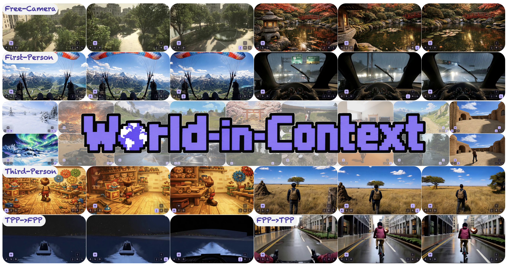
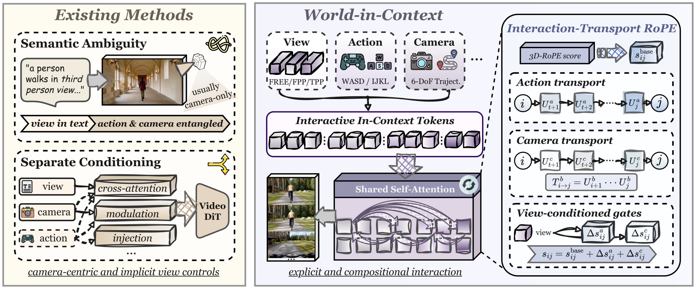
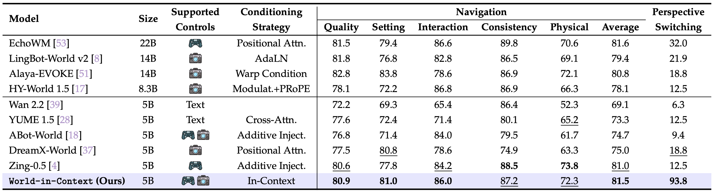

<div align="center">

# World-in-Context

**Interactive Video World Modeling with In-Context Conditioning**

&nbsp;Alibaba Token Hub, Alibaba Group

[](https://haroldchen19.github.io/WiC-site)
[](https://arxiv.org/abs/2610.33169)

</div>



## 💡 Overview

**World-in-Context (WiC)** is a training framework that introduces *In-Context Conditioning (ICC)* for interactive video world models.

ICC unifies view, action, and camera controls as tokens in a shared attention space, enabling free-camera, first-person, and third-person navigation with dynamic perspective switching. *Interaction-Transport RoPE (IT-RoPE)* further incorporates accumulated control transitions into temporal attention.

<div align="center">

</div>

With Wan2.2-TI2V-5B as the backbone, our implementation achieves a **navigation average of 81.5** and **93.8% perspective-switching success** on WBench.

<div align="center">

</div>


## 📋 TODO

The code and WiC weights are currently **under review** and are not yet available. The usage instructions below describe the planned release.

- [ ] Inference Code
- [ ] Training Code
- [ ] WiC weights

## 🚀 Install

Requires Linux, Python 3.10, and an NVIDIA GPU with BF16 support. The tested stack uses PyTorch 2.4, CUDA 12.4, and FlashAttention 2.7.4.

```bash
conda create -n wic python=3.10 -y
conda activate wic
pip install torch==2.4.0 torchvision==0.19.0 --index-url https://download.pytorch.org/whl/cu124
pip install -r requirements.txt
pip install ninja wheel packaging
pip install flash-attn==2.7.4.post1 --no-build-isolation
pip install -e . --no-deps
```

Run commands from the repository root. Training uses gradient checkpointing; GPU memory requirements depend on video size and configuration.

## 📟 Weights and inference

Download the Wan backbone and provide a separate WiC adapter:

```bash
python scripts/download_backbone.py
# Place your WiC adapter at models/WiC/model.safetensors,
# or edit configs/paths.json to point to existing local weights.
python -m wic.infer --all --dry-run
python -m wic.infer --example examples/free_01 --output outputs/demo
python -m wic.infer --all --output outputs/examples
```

The planned release includes **11 examples**: 3 FREE, 3 FPP, 3 TPP, and 2 switching examples, each with an initial image, prompts, and controls. Defaults: **832×480 · 81 frames · 16 FPS · CFG 5 · 50 sampling steps**.

Outputs are `video.mp4` and `ui.mp4` (keyboard overlay). Use `--no-ui` to skip the overlay, or see `docs/data_format.md` (available with the code release) to create your own examples.

## 🌠 Training

Both stages use the same bidirectional architecture. Stage 1 initializes new adapters; Stage 2 initializes from a Stage 1 adapter. Only LoRA, the condition encoder and IT-RoPE are optimized.

```bash
cp configs/train_stage1.json configs/train.local.json  # or train_stage2.json
# Edit configs/train.local.json before launching.
python -m wic.train --config configs/train.local.json --dry-run
bash scripts/train_8gpu.sh --config configs/train.local.json

# Run on every node; use its own NODE_RANK and the same shared config/data paths.
NNODES=2 NODE_RANK=0 MASTER_ADDR=rank-0-hostname GPUS_PER_NODE=8 \
  bash scripts/train_multinode.sh --config configs/train.local.json
```

The per-GPU batch is one clip; adjust `gradient_accumulation_steps` for the effective batch. `condition_mode_weights=null` respects each sample's action-only, camera-only, joint (`both`) or `none` mode. Optional weights are sampled over modes available for that sample. Checkpoints contain adapters only; `init_checkpoint` starts a new optimizer run. Choose a fresh output directory for each run.


## 📝 Citation

```bib
@article{chen2026world,
  title={World-in-Context: Interactive Video World Modeling with In-Context Conditioning},
  author={Chen, Harold Haodong and Peng, Rui and Guo, Rongjin and Qiu, Lingteng and Qiu, Kejie and Xu, Chao and Dong, Zilong},
  journal={arXiv preprint arXiv:2610.33169},
  year={2026}
}
```


## 🔰 Acknowledgments and license

This implementation includes code adapted from [DiffSynth-Studio](https://github.com/modelscope/DiffSynth-Studio) and uses [Wan2.2-TI2V-5B](https://huggingface.co/Wan-AI/Wan2.2-TI2V-5B) as its backbone. Model weights are downloaded separately.

The code is planned for release under [Apache 2.0](LICENSE). Third-party code and model weights remain subject to their respective licenses.

## 📪 Contact

For questions, open an issue or email Harold H. Chen by [haroldchen328@gmail.com](mailto:haroldchen328@gmail.com) ;-)
